# dokumen-ke-ppt

English | [Bahasa Indonesia](README.md)

A skill that turns academic documents (papers, assignments, case studies, reports) into Indonesian-language presentation slides. The source can be .docx, .pdf, .md, or plain text. The output is two files: a PPT with Morph transitions and APA citations, and a .docx with speaker notes and anticipated Q&A.

Current version: v3.2. This skill continues `makalah-ke-ppt` (v1 to v3). Because it was renamed to `dokumen-ke-ppt`, numbering restarted at v1, and it has since moved to v2, v2.1, v2.2, v3.0, v3.1, and v3.2. The full list of changes per version is in [CHANGELOG.md](CHANGELOG.md) (written in Indonesian). By default the slides and speaker notes are in Indonesian; use `--en` for English.

## Contents

- [Output](#output)
- [How it works](#how-it-works)
- [Requirements](#requirements)
- [Installation](#installation)
- [Usage](#usage)
- [Repository layout](#repository-layout)
- [Version history](#version-history)
- [Known limitations](#known-limitations)
- [Troubleshooting](#troubleshooting)
- [Author](#author)
- [License](#license)

## Output

- `PPT - [title].pptx`: an opening slide, one content slide per sub-topic, and a closing "Terima Kasih" (Thank You) slide. Slides are kept concise (3 to 4 points, one short sentence each) and every slide has a full speaker-notes script.
- `Speaker Notes - [title].docx`: the full scripts for all slides in one document (Times New Roman 12) for a presentation of at most 15 minutes (or another duration you state), plus an Anticipated Questions section (3 to 5 Q&A pairs for the Q&A session). `[title]` comes from the source title (70 characters at most). If it is longer, the subtitle is dropped first, then the rest is condensed into a complete core phrase, and the title used is stated in the reply.

## How it works

1. The skill reads the source with `scripts/baca_sumber.py` (clean text, references split off, cover logo, images, OCR for scanned PDFs, conversion of Word equations) and extracts the identity details: title, group, members, course, lecturer. The university, faculty, and study program names from the cover are shown as text on the opening slide (no logo).
2. Anything still unknown (missing identity details, slide count and structure for non-paper sources, color, font) is asked in a single round of questions. Missing details are asked for, never invented.
3. A slide plan is written first: the title and sub-topics covered by each slide. Without a number from you, the slide count follows the material: at most 10 (fewer is fine), and more than 10 if there are more than 8 sub-topics.
4. Slides are built with one of 30 themes (or a plain color), Lucide icons, and 15 varied slide types, including native charts and tables, process flows (`langkah`), a clickable agenda (page numbers link back to it), and chapter dividers. Everything is built from a single `isi.json` file, which `scripts/cek_isi.py` checks first (dry run). Decorative elements use the same `!!`-prefixed object names on every slide so Morph pairs them and animates smoothly. Images, tables, formulas, and Arabic text are handled according to their type.
5. Full speaker-notes scripts are written per slide (130 words per minute, 15 minutes at most) and collected into the .docx file together with the anticipated questions.
6. Transitions are added (Morph, Fade, or a combination), the style's colors and fonts are written into the PowerPoint theme so slides you add yourself match, the PPT is validated, and every slide is rendered to an image and checked for clipped text, overlapping elements, stretched images, and fidelity to the source.

## Requirements

This skill uses the `SKILL.md` format and works in Claude (the app or Claude Code), OpenClaw, and Hermes Agent. The machine the agent runs on needs:

- Python 3 with `matplotlib`, `Pillow`, and `python-pptx`: `pip install matplotlib pillow python-pptx`
- Node.js (current LTS) with `pptxgenjs`, `docx`, and `sharp`: `npm install -g pptxgenjs docx sharp`. If `require` fails while the skill runs, the agent uses `NODE_PATH=$(npm root -g)`.
- LibreOffice (`soffice`) and `pdftoppm` (Poppler), for rendering slides to images during checks.
- `pdftotext` and `pdfimages` (Poppler), for reading PDFs and extracting the logo.
- Optional: `pandoc` (Word equation conversion) and `tesseract` with the Indonesian language pack (OCR for scanned PDFs).
- Optional: Claude's built-in `pptx` skill (PPT validation with `validate.py`). If it is missing, the skill checks the file with `python-pptx`.
- Theme fonts (e.g. Palatino Linotype or Century Gothic) or Poppins, Lato, and Amiri (Amiri is only for Arabic text) on the computer that opens the PPT. If unsure, use `--fontaman`.
- PowerPoint 2019++ or 365 to see Morph transitions.

Quick check after installing the packages:

```
node -e "require('pptxgenjs');require('docx');require('sharp');console.log('node ok')"
python3 -c "import matplotlib, PIL, pptx; print('python ok')"
soffice --version && pdftoppm -v
```

## Installation

This repository is the skill folder itself: `SKILL.md` sits at the repository root. Three rules apply to every agent:

- The folder name must be `dokumen-ke-ppt` (the same as `name` in `SKILL.md`).
- The `scripts/` and `aset/` folders (themes, backgrounds, icons, about 6 MB) must be copied too. Install with `git clone`, or copy the whole folder, not just `SKILL.md`.
- If you still have the old `makalah-ke-ppt` skill, remove it so the two do not compete.

### Claude Code

For all projects (personal skill):

```
git clone https://github.com/kurniawanhafiz/dokumen-ke-ppt.git ~/.claude/skills/dokumen-ke-ppt
```

Windows (PowerShell):

```
git clone https://github.com/kurniawanhafiz/dokumen-ke-ppt.git "$env:USERPROFILE\.claude\skills\dokumen-ke-ppt"
```

For a single project, clone into `.claude/skills/dokumen-ke-ppt` at the project root (the folder can be committed so a whole team gets it).

Then run `claude` in the folder that holds your document. If you just created `~/.claude/skills`, restart Claude Code. Check by asking "what skills are available?" or typing `/dokumen-ke-ppt`. Example:

```
/dokumen-ke-ppt buatkan PPT dari makalah.pdf --tema=rekomendasi
```

The results (`PPT - [title].pptx` and `Speaker Notes - [title].docx`) are saved in the working folder.

### OpenClaw

Install on the machine where the OpenClaw Gateway runs. The default location is the agent workspace:

```
git clone https://github.com/kurniawanhafiz/dokumen-ke-ppt.git ~/.openclaw/workspace/skills/dokumen-ke-ppt
```

Other locations:

| Location | Who uses it |
|---|---|
| `~/.openclaw/workspace/skills/` | The agent that owns that workspace (highest precedence) |
| `~/.agents/skills/` | All your agents |
| `~/.openclaw/skills/` | Every agent on the Gateway |

Then make sure it is detected:

```
openclaw skills check
openclaw skills info dokumen-ke-ppt
```

OpenClaw watches skill folders, so a new skill is usually picked up right away. If it does not show up in a running session, start a new one with `/new` in chat, or restart the Gateway. If the agent runs in a Docker sandbox, Python, Node.js, LibreOffice, and the packages under Requirements must exist inside the sandbox (for example through your own image or `agents.defaults.sandbox.docker.setupCommand`). OpenClaw versions that support git sources can also use `openclaw skills install git:kurniawanhafiz/dokumen-ke-ppt`; check `openclaw skills install --help` first.

### Hermes Agent

Hermes keeps all skills in `~/.hermes/skills/`:

```
git clone https://github.com/kurniawanhafiz/dokumen-ke-ppt.git ~/.hermes/skills/dokumen-ke-ppt
```

Hermes on Windows is most stable through WSL2 (same path, `~/.hermes`). On a native Windows install the folder is `%LOCALAPPDATA%\hermes\skills\dokumen-ke-ppt`.

If you want this skill to stay outside the Hermes folder (for example one skills folder shared by several agents), clone it anywhere and register it in `~/.hermes/config.yaml`:

```yaml
skills:
  external_dirs:
    - ~/my-skills     # the folder that contains dokumen-ke-ppt/
```

Check with `hermes skills list`, then call it in chat with `/dokumen-ke-ppt ...`. If the skill was added while a session is open, run `/reload-skills`.

Do not install through `hermes skills install https://.../SKILL.md` or the GitHub install command: those only copy `SKILL.md` and files from `references/`, `templates/`, `scripts/`, `assets/`, and `examples/`, while this skill's `aset/` folder (themes, backgrounds, icons) is not copied, so themes and icons would be missing.

### Claude (app) and ZIP

Download the ZIP from `https://github.com/kurniawanhafiz/dokumen-ke-ppt/archive/refs/heads/main.zip`, extract it, and rename the folder to `dokumen-ke-ppt` (the extracted folder is named `dokumen-ke-ppt-main`). For the Claude app, upload a ZIP of the `dokumen-ke-ppt` folder through the skills settings following Anthropic's official instructions. For other agents, copy the folder to one of the locations above.

### Updating

```
git -C ~/.claude/skills/dokumen-ke-ppt pull
```

Replace the path with where you installed it (`~/.openclaw/workspace/skills/dokumen-ke-ppt` or `~/.hermes/skills/dokumen-ke-ppt`). If you edit the skill files, keep your changes on your own branch so `git pull` does not conflict.

## Usage

Invoke the skill with `/dokumen-ke-ppt`, or simply ask for a presentation from your document. Put flags in the prompt, or ask for the same thing in plain words ("make it purple", "10 slides only").

### Flags

| Flag | What it does |
|---|---|
| `--tema=<name or number>` | Full theme (colors, background image, title font), 30 choices. Plain words work too (`--tema=kesehatan`, `--tema=galaxy`). List by category: `python3 scripts/gaya.py --daftar`; picture catalog: `docs/katalog_30_tema.jpg` |
| `--tema=rekomendasi` | The theme is picked automatically from the topic |
| `--warna=<name or hex>` | Plain style without a background image: `hijau`, `navy`, `marun`, `teal`, `cokelat`, `hitam`, another name (`ungu`), or hex (`--warna=#7A1F5C`) |
| `--singkat` `--padat` `--poin` | Wording style: 3 to 4 points of about 50 words (default), 4 to 5 full-sentence points of about 80 words, or 3 short phrases |
| `--transisi=morph`, `fade`, or `kombinasi` | Slide transition. `morph` (default) on every slide; `fade` is safest for Google Slides, Keynote, and Canva; `kombinasi` is Morph with Push on chapter dividers and Wipe on chart slides |
| `--bagi` | Speaker notes list the speaker per member and the duration of each slide |
| `--pustaka` | Adds a References slide before the closing slide |
| `--slide=N` | Exactly N slides in total (minimum 5, including extra slides; no Agenda or chapter dividers) |
| `--fontaman` | Use Calibri (and Traditional Arabic for Arabic text) so it displays correctly on any computer |
| `--en` | Slides, notes, and the notes document in English |

The old flags `--hijau`, `--navy`, and so on were replaced by `--warna=hijau`, `--warna=navy`, and so on. If both `--tema` and `--warna` are given, the theme wins.

If no theme or color flag is given, the skill asks for the visual style (recommended theme, plain color, or your choice) and then the wording style, together with its other questions in one round. A custom color that is too light is darkened automatically so the text stays readable, and the skill says so in its reply.

### Theme gallery

Use with `--tema=name` or `--tema=number`. Each image shows the opening slide (left) and a content slide (right) from a sample deck built by this skill. Fonts in the images are LibreOffice approximations; PowerPoint uses the installed theme fonts. Theme descriptions are in Indonesian.

**1. Awesome** (`--tema=awesome`): Aurora neon gelap, judul gradien. Good for: Lomba, topik kreatif.  
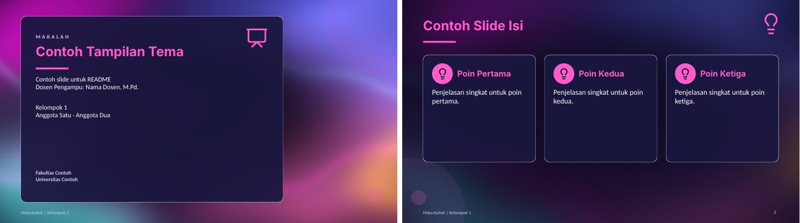

**2. Minimalis** (`--tema=minimalis`): Kertas putih, tinta hitam, aksen oranye. Good for: Jurnal, skripsi, tesis.  
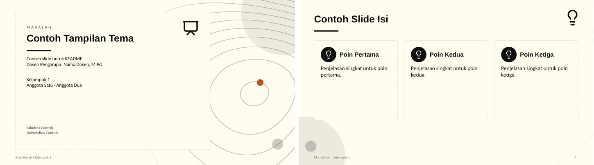

**3. Cyberpunk** (`--tema=cyberpunk`): Matahari retro, grid neon. Good for: Teknologi, AI.  
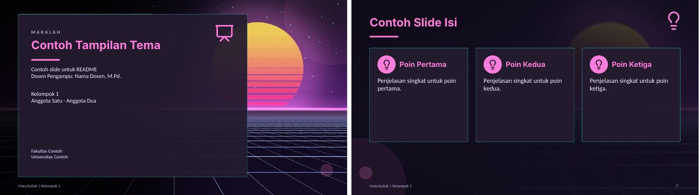

**4. Premium Design** (`--tema=premium`): Hitam keunguan dan emas. Good for: Proposal bisnis, acara resmi.  
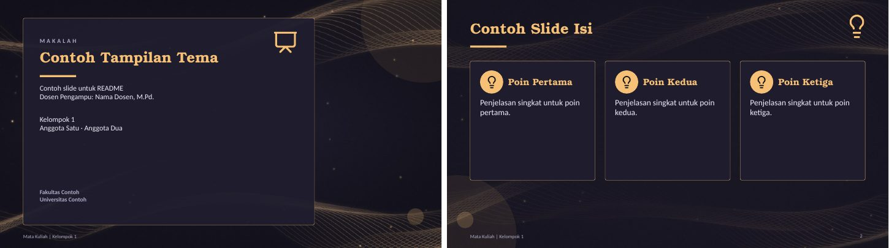

**5. Natural** (`--tema=natural`): Bukit hijau, matahari lembut. Good for: Lingkungan, pangan.  
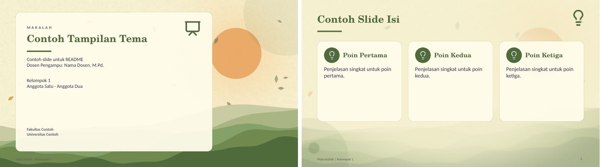

**6. Forest** (`--tema=forest`): Hutan malam berkabut. Good for: Kehutanan, konservasi.  
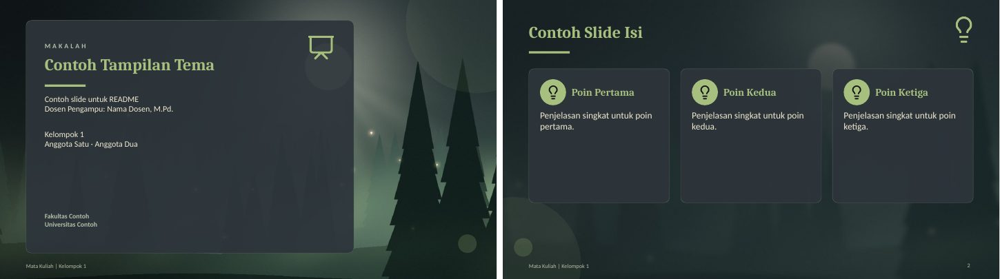

**7. Modern** (`--tema=modern`): Putih bersih, bola warna. Good for: Seminar, sidang.  
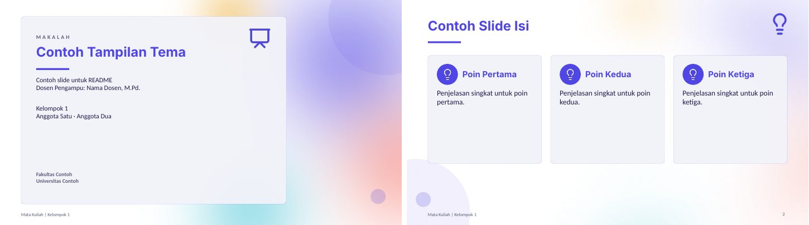

**8. Dinamis** (`--tema=dinamis`): Navy, garis kecepatan. Good for: Presentasi energik.  
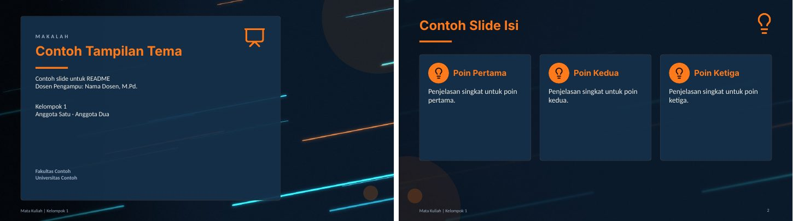

**9. Funny** (`--tema=funny`): Krem ceria, konfeti. Good for: Kelas santai.  
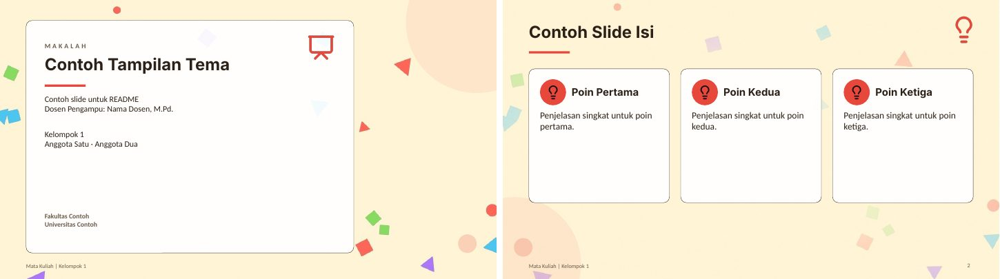

**10. Galaksi** (`--tema=galaksi`): Nebula, bintang, planet bercincin. Good for: Astronomi, fisika, sains.  
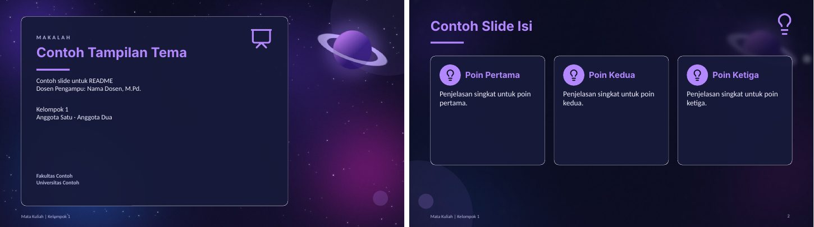

**11. Samudra** (`--tema=samudra`): Bawah laut, sinar cahaya, gelembung. Good for: Kelautan, perikanan.  
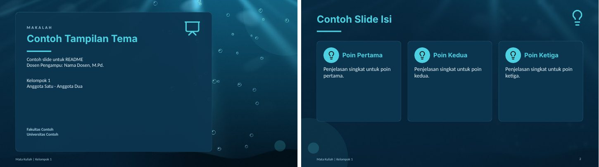

**12. Sakura** (`--tema=sakura`): Ranting sakura, kelopak berjatuhan. Good for: Budaya Asia, sastra.  
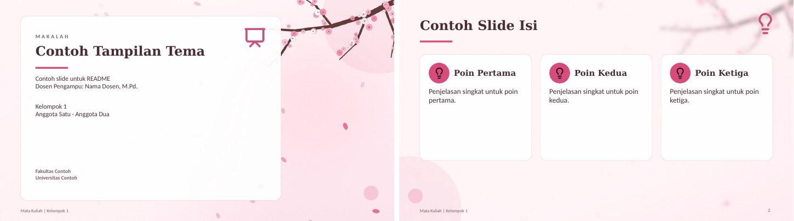

**13. Batik Nusantara** (`--tema=batik`): Motif kawung cokelat dan emas. Good for: Budaya dan sejarah Indonesia.  
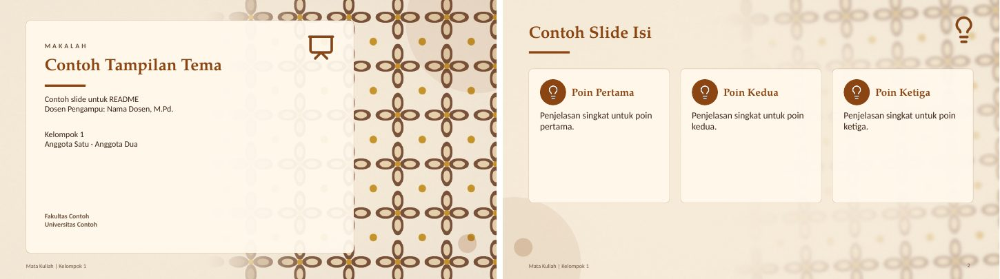

**14. Geometri Islami** (`--tema=islami`): Bintang delapan emas di atas zamrud. Good for: Studi Islam, pendidikan agama.  
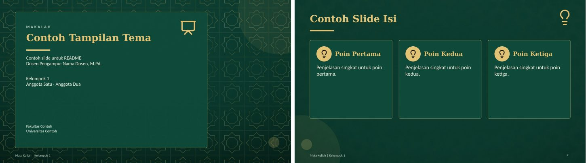

**15. Matrix** (`--tema=matrix`): Hujan kode hijau. Good for: Pemrograman, keamanan siber.  
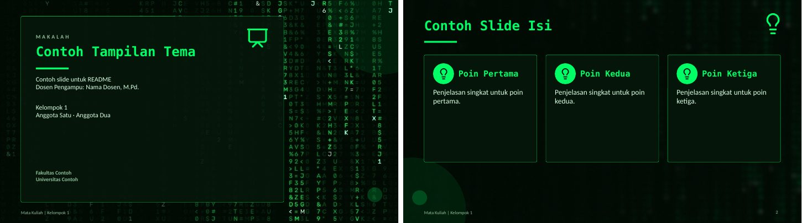

**16. Blueprint** (`--tema=blueprint`): Gambar teknik, roda gigi berputar. Good for: Teknik, arsitektur.  
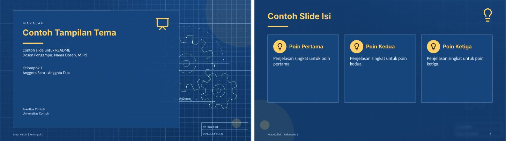

**17. Papan Tulis** (`--tema=papantulis`): Rumus kapur yang tergambar sendiri. Good for: Pendidikan, matematika.  
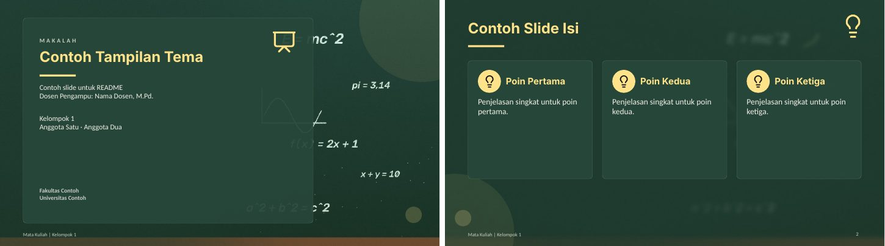

**18. Buku Catatan** (`--tema=catatan`): Kertas bergaris, coretan pena. Good for: Tugas kuliah, catatan belajar.  
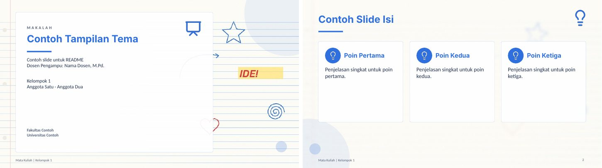

**19. Pastel** (`--tema=pastel`): Gelembung pastel lembut. Good for: Psikologi, anak, PAUD.  
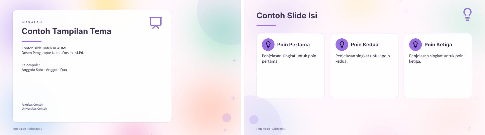

**20. Medis** (`--tema=medis`): Garis EKG dan DNA berputar. Good for: Kesehatan, kedokteran.  
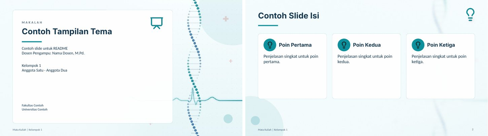

**21. Korporat** (`--tema=korporat`): Navy dengan pita diagonal. Good for: Bisnis, manajemen, ekonomi.  
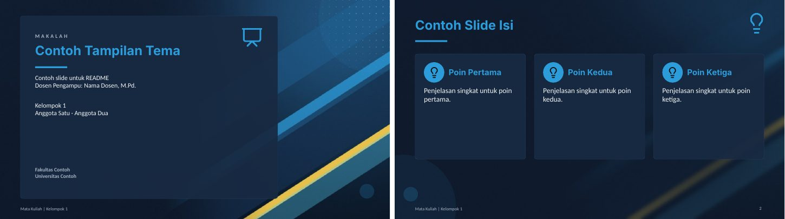

**22. Monokrom** (`--tema=monokrom`): Hitam putih, garis spirograf. Good for: Hukum, karya formal.  
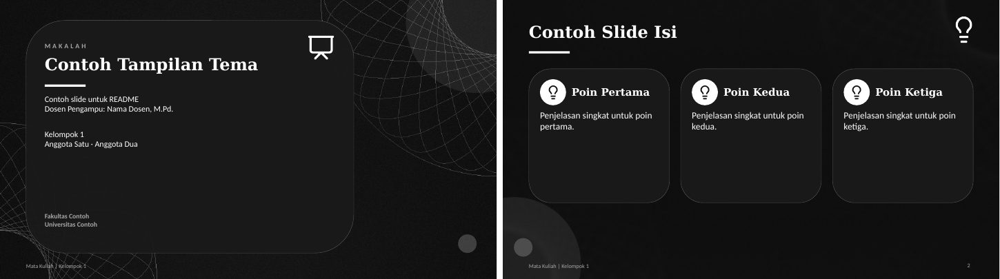

**23. Jaringan** (`--tema=jaringan`): Titik-titik terhubung yang bergerak. Good for: Data, jaringan komputer.  
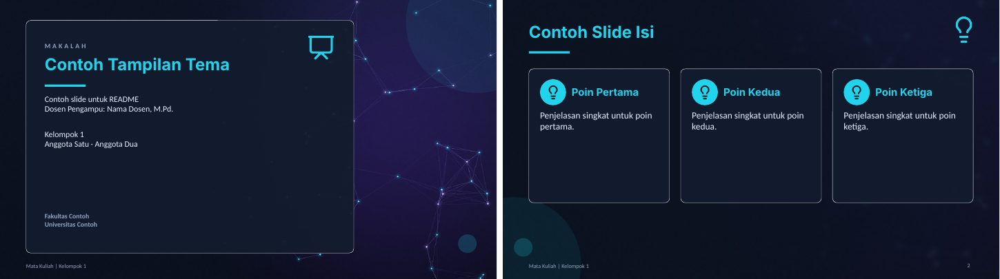

**24. Salju** (`--tema=salju`): Pegunungan malam, salju turun. Good for: Iklim, geografi.  
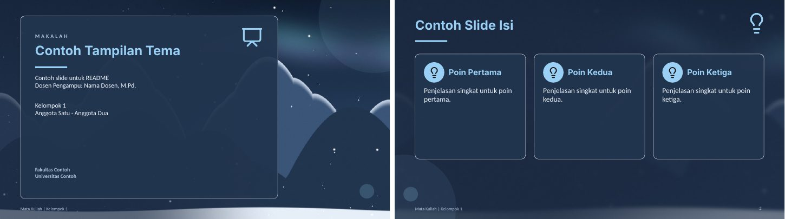

**25. Tropis** (`--tema=tropis`): Pantai, matahari, daun palem. Good for: Pariwisata, pesisir.  
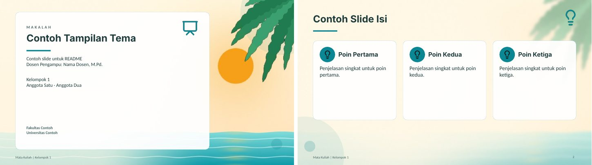

**26. Lava** (`--tema=lava`): Gumpalan lava yang mengalir. Good for: Energi, kebencanaan, kimia.  
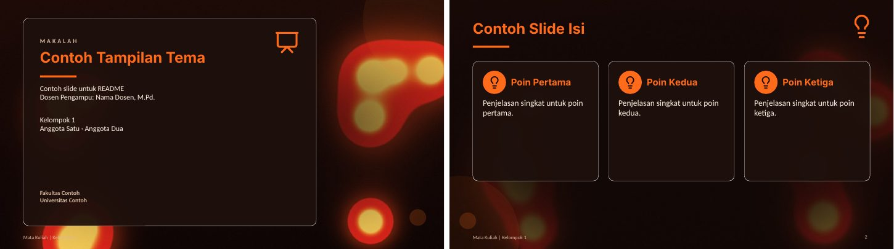

**27. Vintage** (`--tema=vintage`): Kertas tua, butiran film, ornamen. Good for: Sejarah, sastra, arsip.  
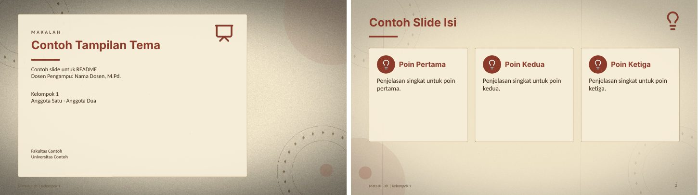

**28. Bauhaus** (`--tema=bauhaus`): Bentuk geometris warna primer. Good for: Seni, desain grafis.  
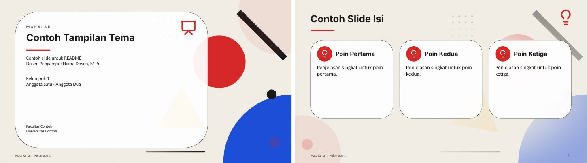

**29. Pixel** (`--tema=pixel`): Langit dan awan gaya game retro. Good for: Game, multimedia.  
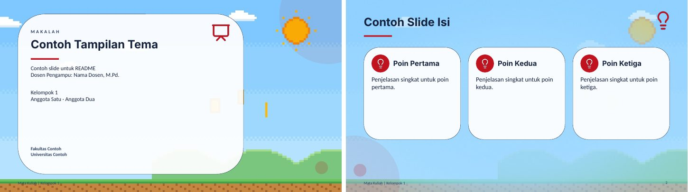

**30. Holografik** (`--tema=holografik`): Gradien pelangi berkilau. Good for: Desain, topik kreatif.  
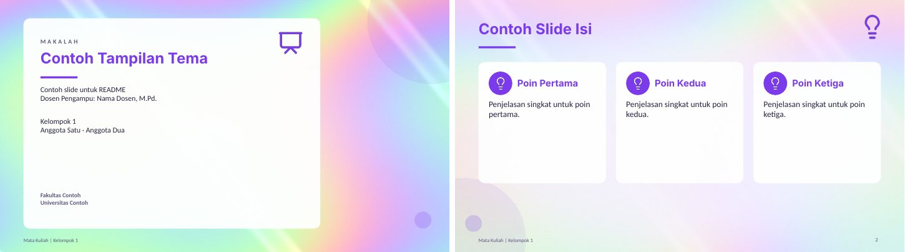

### Plain colors (`--warna`)

No background image: cream content slides, cover and closing in the main color. Built-in choices below; other names (`--warna=ungu`) or hex (`--warna=#7A1F5C`) also work, and colors that are too light are darkened automatically.

| Flag | Main color | Sample |
|---|---|---|
| `--warna=hijau` | #1E4D3B | 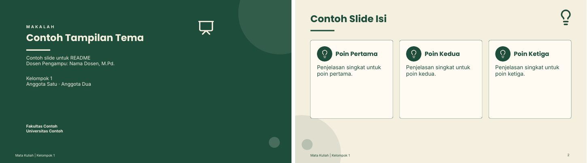 |
| `--warna=navy` | #1B2A4A | 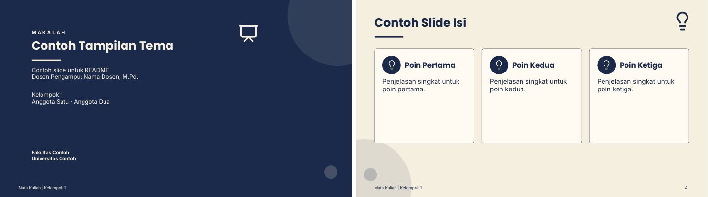 |
| `--warna=marun` | #6B1E2E | 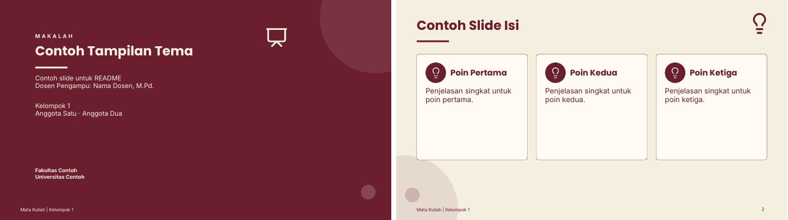 |
| `--warna=teal` | #134E4A | 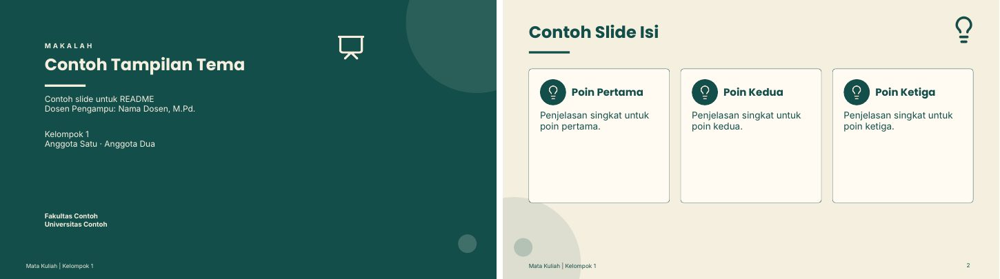 |
| `--warna=cokelat` | #4A2F1F | 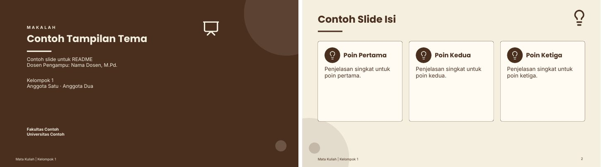 |
| `--warna=hitam` | #1C1C1E (aksen emas tipis di garis judul) | 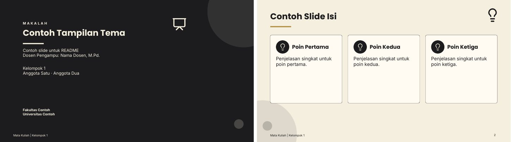 |


### Example prompts

A regular paper:

```
/dokumen-ke-ppt buatkan PPT dari makalah terlampir --tema=rekomendasi --padat
```

A non-paper assignment (case study, report). The skill offers a slide structure first because the source has no chapters:

```
/dokumen-ke-ppt buatkan PPT dari tugas studi kasus BPMN terlampir --warna=hijau --slide=10
```

A group presentation with speaker assignment. Each slide gets a line `Pembicara: [Name] | Durasi: ±N menit`, and the notes .docx includes a summary table of the assignments:

```
/dokumen-ke-ppt buatkan PPT dari makalah terlampir --tema=korporat --bagi, total durasi 15 menit
```

A custom color:

```
/dokumen-ke-ppt buatkan PPT dari makalah terlampir --warna=#7A1F5C
```

## Repository layout

```
dokumen-ke-ppt/
├── SKILL.md            Core flow and rules read by Claude
├── references/         Per-step details (Claude reads them only when needed)
├── README.md           Documentation (Indonesian)
├── README.en.md        Documentation (English)
├── CHANGELOG.md        Change history per version (Indonesian)
├── LICENSE             GNU General Public License v3
├── .gitignore
├── docs/               Theme and color gallery images for the README, katalog_30_tema.jpg
├── aset/
│   ├── tema.json       30 themes (colors, fonts)
│   ├── kata_ikon.json  Keyword-to-icon map
│   ├── latar/          Content-slide backgrounds per theme
│   ├── poster/         Cover images per theme
│   └── ikon/           Lucide icons + LICENSE-lucide.txt
└── scripts/
    ├── baca_sumber.py
    ├── gaya.py
    ├── cek_isi.py
    ├── bangun_ppt.js
    ├── buat_notes.js
    ├── add_morph.py
    ├── render_rumus.py
    ├── ikon.py
    ├── palette.py
    └── susun.js
```

### scripts/

The skill calls these scripts automatically. This section is for running them by hand, from the repository root.

**baca_sumber.py** reads a .docx, .pdf, .md, or .txt and writes `sumber.txt` (clean text), `pustaka.txt`, `logo.png`, `_gambar/`, and `ringkasan.json` (detected chapters, cover, equations, template placeholders, whether OCR was used) to the `--keluar` folder.

```
python3 scripts/baca_sumber.py makalah.docx --keluar=kerja
python3 scripts/baca_sumber.py laporan.pdf --keluar=kerja --halaman=7   # also render page 7
```

**gaya.py** turns `--tema` or `--warna` into a style JSON (colors, fonts, background image paths) and recommends a theme from the topic.

```
python3 scripts/gaya.py --daftar
python3 scripts/gaya.py --tema=batik
python3 scripts/gaya.py --tema=kesehatan                  # plain words work too
python3 scripts/gaya.py --tema=rekomendasi --topik "discrete mathematics"
python3 scripts/gaya.py "--warna=#7A1F5C" --fontaman
```

**cek_isi.py** is a dry run for `isi.json`: it normalizes item shapes, checks charts (value count, Indonesian number format), per-slide item limits, wording density, empty notes, script length against the duration, image and icon files, and counts the total slides. `--pecah` splits slides with too many items, `--tulis` saves the tidied result.

```
python3 scripts/cek_isi.py isi.json --gaya-kata=singkat --durasi=15 --slide=12
python3 scripts/cek_isi.py isi.json --pecah --tulis
```

**bangun_ppt.js** builds the raw .pptx from `isi.json` (format in `references/gaya-dan-isi-json.md`), and **buat_notes.js** builds the Speaker Notes document from the same file.

```
node scripts/bangun_ppt.js isi.json PPT-mentah.pptx
node scripts/buat_notes.js isi.json "Speaker Notes - title.docx"
```

**add_morph.py** adds a transition to every slide of a .pptx (`--transisi=morph|fade|kombinasi`), writes the style's colors and fonts into the PowerPoint theme (`--gaya=gaya.json`), and warns when objects are not named `!!...`. It is safe to run again, and the output file must differ from the input file.

```
python3 scripts/add_morph.py PPT-mentah.pptx PPT-final.pptx --gaya=gaya.json --transisi=kombinasi
```

**ikon.py** colors Lucide icons and picks an icon from keywords.

```
python3 scripts/ikon.py --auto "tujuan penulisan"
python3 scripts/ikon.py --color 1B2A4A --out ikon target users
```

**render_rumus.py** renders math formulas (matplotlib mathtext syntax, a subset of LaTeX) into transparent PNGs.

```
python3 scripts/render_rumus.py --color 1B2A4A --size 32 --out rumus1.png "\binom{n}{k}=\frac{n!}{k!(n-k)!}"
python3 scripts/render_rumus.py --color F4F1E8 --batch rumus.json   # many formulas at once
```

## Version history

The current version is **v3.2**. Changes for each version (v1, v2, v2.1, v2.2, v3.0, v3.1, v3.2) are recorded in [CHANGELOG.md](CHANGELOG.md), newest first. The changelog is written in Indonesian.

## Known limitations

- **Morph:** only shown in PowerPoint 2019++ and 365. Matching objects across slides are paired by `!!`-prefixed names; `add_morph.py` warns when those names are missing. Other apps fall back to a fade (or use `--transisi=fade` from the start). LibreOffice previews do not show Morph either, so the motion can only be checked in PowerPoint itself.
- **Fonts:** theme fonts (e.g. Palatino Linotype, Century Gothic) or Poppins, Lato, and Amiri must be installed on the computer that opens the PPT. Otherwise PowerPoint substitutes fonts and the layout may shift. Use `--fontaman` for Calibri. In unattended sessions the skill uses the safe fonts automatically. The PPT file does not embed fonts.
- **Language:** slides and notes are in Indonesian, including for English sources (technical terms are kept). Use `--en` for English output.
- **Formulas:** rendered as images, so they cannot be edited in PowerPoint. One-line formulas without fractions or roots are written as plain text.
- **Animation:** transitions between slides only (Morph, Fade, Push, Wipe). Per-object entrance animations (for example cards appearing one by one) are not included.
- **Style:** the plain style (`--warna`) always uses a cream background (#F5EFE0) and only the main color changes. Themed decks use static backgrounds, no background video, so files stay light and open in Google Slides or Canva.
- **Charts and tables:** native, so they can be edited in PowerPoint, but only built from data found in the source. Tables are at most 5 rows by 4 columns.
- **Network:** installing npm packages needs access to the registry. Where that is not available, the packages must already be installed.
- **Unattended sessions:** if the skill runs without being able to ask questions, it uses `--warna=navy`, the safe fonts, the `--singkat` wording style, and the default slide-count rules, and says so in its reply.
- **Scanned PDFs:** OCR can misread numbers, names, and verses. The skill flags these as "needs manual check".
- **Accuracy:** the skill keeps numbers, definitions, names, and verses identical to the source, but double-check before presenting.

## Troubleshooting

| Symptom | Cause | Fix |
|---|---|---|
| Fonts look wrong or different | Fonts are not installed | Install the fonts, or regenerate with `--fontaman` |
| Transition does not animate | Not PowerPoint 2019++/365 | Open in PowerPoint and check the Transitions tab: it should say Morph |
| Morph runs but objects do not glide | Object names lack the `!!` prefix or differ between slides | Heed the `add_morph.py` warnings and use the same `!!judul`, `!!ikon`, etc. names |
| `File keluaran harus beda dari file masukan.` | `add_morph.py` input and output names are the same | Give the output a different name |
| `Cannot find module 'sharp'` or `'docx'` | An npm package was not found | Run with `NODE_PATH=$(npm root -g) node ...` or `npm install sharp docx pptxgenjs` |
| `npm install` fails with `ENOTFOUND registry.npmjs.org` | The npm registry is unreachable from this network | Use globally installed packages, or install from another network |
| `PERINGATAN: ikon '...' tidak ada` | Wrong icon name | Check `python3 scripts/ikon.py --daftar`; `lightbulb` is used instead |
| `PERINGATAN: slide contoh ... terlalu panjang` | A `contoh` slide overflows its card | Lower `skalaRumus`, trim the content, or split the slide |
| `Tema '...' tidak dikenali.` | Wrong theme name or number | Run `python3 scripts/gaya.py --daftar` |
| `ERROR: ... jumlah nilai ... label` from `cek_isi.py` | A chart series has a different number of values than labels | Make the counts equal in `isi.json` |
| `--transisi harus salah satu dari ...` | Mistyped `--transisi` value | Use `morph`, `fade`, or `kombinasi` |
| `require('pptxgenjs')` fails | Node cannot find the global package | Run with `NODE_PATH=$(npm root -g) node ...` |
| `render_rumus.py` raises a mathtext error | Unsupported LaTeX command | Simplify the formula; `\frac`, `\binom`, `\sqrt`, superscripts, and subscripts are supported |
| `Warna '...' tidak dikenali.` | Color name is not in the list | Use hex: `--warna=#RRGGBB` |
| Result is darker than the requested color | Contrast against cream is below 4.5 (`--warna` only) | This is intentional so the text stays readable; pick a darker color yourself for an exact match |

## Author

Created by **Kurniawan Hafiz**. Copyright (c) 2026 Kurniawan Hafiz.

## License

Since v3.2 this skill is released under the [GNU General Public License v3.0](LICENSE) or any later version (`GPL-3.0-or-later`). Copies of v3.1 and earlier that were already shared under the MIT license remain MIT-licensed for those who received them.

The icons in `aset/ikon/` come from [Lucide](https://github.com/lucide-icons/lucide) and remain under the ISC license (see `aset/ikon/LICENSE-lucide.txt`).
