# dokumen-ke-ppt

[English](README.en.md) | Bahasa Indonesia

Skill untuk mengubah dokumen akademik (makalah, tugas, studi kasus, laporan) menjadi PPT presentasi berbahasa Indonesia. Sumber boleh berupa .docx, .pdf, .md, atau teks biasa. Hasilnya dua file: PPT dengan transisi Morph dan kutipan APA, serta dokumen .docx berisi speaker notes.

Versi saat ini: v3.2. Skill ini melanjutkan `makalah-ke-ppt` (v1 sampai v3). Karena namanya baru, penomoran dimulai lagi dari v1 saat berganti nama menjadi `dokumen-ke-ppt`, lalu naik ke v2, v2.1, v2.2, v3.0, v3.1, dan v3.2. Daftar lengkap perubahan tiap versi ada di [CHANGELOG.md](CHANGELOG.md).

## Daftar isi

- [Yang dihasilkan](#yang-dihasilkan)
- [Cara kerja singkat](#cara-kerja-singkat)
- [Persyaratan](#persyaratan)
- [Cara pasang](#cara-pasang)
- [Cara pakai](#cara-pakai)
- [Isi repo](#isi-repo)
- [Riwayat versi](#riwayat-versi)
- [Batasan yang diketahui](#batasan-yang-diketahui)
- [Pemecahan masalah](#pemecahan-masalah)
- [Pembuat](#pembuat)
- [Lisensi](#lisensi)

## Yang dihasilkan

- `PPT - [judul].pptx`: slide pembuka, (Agenda dan pembatas bab jika ada 3 bab atau lebih), slide isi per sub-materi, dan slide Terima Kasih. Slide dibuat ringkas (gaya kata bawaan 3 sampai 4 poin, satu kalimat singkat per poin) dan setiap slide punya naskah speaker notes lengkap.
- `Speaker Notes - [judul].docx`: naskah semua slide dalam satu dokumen (Times New Roman 12) untuk presentasi maksimal 15 menit (atau durasi lain yang kamu sebut), ditambah bagian Pertanyaan Antisipasi (3 sampai 5 tanya jawab untuk sesi tanya jawab). `[judul]` adalah judul sumber (maksimal 70 karakter). Jika lebih panjang, subjudul dibuang dulu, lalu diringkas jadi frasa inti yang utuh, dan judul yang dipakai disebut di balasan.

## Cara kerja singkat

1. Skill membaca sumber lewat `scripts/baca_sumber.py` (teks bersih, daftar pustaka dipisah, logo cover, gambar, OCR untuk PDF scan, konversi rumus Word) dan mengambil identitas: judul, kelompok, anggota, mata kuliah, dosen. Nama universitas, fakultas, dan program studi dari cover dipakai sebagai teks di slide pembuka (logo hanya jika ada di cover atau kamu lampirkan).
2. Hal yang belum diketahui (identitas yang hilang, struktur dan jumlah slide, tema atau warna, gaya kata, font) ditanyakan sekaligus dalam satu kali tanya. Data yang tidak ditemukan ditanyakan, tidak dikarang.
3. Rencana slide dituliskan lebih dulu: judul dan sub-materi yang dicakup tiap slide. Tanpa angka dari kamu, jumlah slide mengikuti materi: maksimal 10 (boleh kurang), dan lebih dari 10 jika sub-materi lebih dari 8.
4. Slide dibuat dari satu berkas `isi.json` dengan salah satu dari 30 tema (atau warna polos), ikon Lucide, dan 15 tipe slide yang bervariasi, termasuk grafik dan tabel native, alur proses (`langkah`), agenda yang bisa diklik (nomor halaman menaut balik ke Agenda), dan pembatas bab. `isi.json` diperiksa lebih dulu oleh `scripts/cek_isi.py` (dry-run). Elemen dekoratif memakai nama objek berawalan `!!` yang sama di setiap slide supaya Morph memasangkannya dan bergerak halus. Gambar, tabel, rumus, dan teks Arab ditangani sesuai jenisnya.
5. Naskah speaker notes ditulis lengkap per slide (patokan 130 kata per menit, total maksimal 15 menit), lalu dikumpulkan ke dalam file .docx bersama pertanyaan antisipasi.
6. Transisi dipasang (Morph, Fade, atau kombinasi), warna dan font gaya ditulis ke tema PowerPoint supaya slide yang kamu tambah sendiri ikut serasi, PPT divalidasi, lalu setiap slide dirender menjadi gambar dan diperiksa: teks terpotong, elemen tumpang tindih, gambar melar, kesesuaian isi dengan sumber.

## Persyaratan

Skill ini berformat `SKILL.md` dan bisa dipakai di Claude (aplikasi atau Claude Code), OpenClaw, dan Hermes Agent. Mesin tempat agen berjalan membutuhkan:

- Python 3 dengan `matplotlib`, `Pillow`, dan `python-pptx`: `pip install matplotlib pillow python-pptx`
- Node.js (versi LTS terbaru) dengan `pptxgenjs`, `docx`, dan `sharp`: `npm install -g pptxgenjs docx sharp`. Jika `require` gagal saat skill jalan, agen memakai `NODE_PATH=$(npm root -g)`.
- LibreOffice (`soffice`) dan `pdftoppm` (Poppler), untuk merender slide menjadi gambar saat pemeriksaan.
- `pdftotext` dan `pdfimages` (Poppler) untuk membaca PDF dan mengambil logo.
- Opsional: `pandoc` (konversi rumus Word) dan `tesseract` dengan paket bahasa Indonesia (OCR untuk PDF scan).
- Opsional: skill `pptx` bawaan Claude (validasi PPT dengan `validate.py`). Jika tidak ada, skill memeriksa file dengan `python-pptx`.
- Font tema (mis. Palatino Linotype atau Century Gothic) atau Poppins, Lato, dan Amiri (Amiri hanya untuk teks Arab) di komputer yang membuka PPT. Jika tidak yakin, pakai `--fontaman`.
- PowerPoint 2019++ atau 365 untuk melihat transisi Morph.

Cek cepat setelah memasang paket:

```
node -e "require('pptxgenjs');require('docx');require('sharp');console.log('node ok')"
python3 -c "import matplotlib, PIL, pptx; print('python ok')"
soffice --version && pdftoppm -v
```

## Cara pasang

Repo ini adalah folder skill itu sendiri: `SKILL.md` ada di akar repo. Tiga aturan berlaku di semua agen:

- Nama folder harus `dokumen-ke-ppt` (sama dengan `name` di `SKILL.md`).
- Folder `scripts/` dan `aset/` (tema, latar, ikon, sekitar 6 MB) harus ikut tersalin. Pasang dengan `git clone`, atau salin seluruh folder, bukan hanya `SKILL.md`.
- Jika kamu masih punya skill lama `makalah-ke-ppt`, hapus supaya tidak ada dua skill yang bersaing.

### Claude Code

Untuk semua proyek (skill pribadi):

```
git clone https://github.com/kurniawanhafiz/dokumen-ke-ppt.git ~/.claude/skills/dokumen-ke-ppt
```

Windows (PowerShell):

```
git clone https://github.com/kurniawanhafiz/dokumen-ke-ppt.git "$env:USERPROFILE\.claude\skills\dokumen-ke-ppt"
```

Untuk satu proyek saja, clone ke `.claude/skills/dokumen-ke-ppt` di akar proyek (folder itu bisa di-commit supaya dipakai satu tim).

Lalu jalankan `claude` di folder yang berisi dokumenmu. Jika folder `~/.claude/skills` baru kamu buat, restart Claude Code. Cek dengan menanyakan "skill apa yang tersedia?" atau mengetik `/dokumen-ke-ppt`. Contoh pemakaian:

```
/dokumen-ke-ppt buatkan PPT dari makalah.pdf --tema=rekomendasi
```

Hasil (`PPT - [judul].pptx` dan `Speaker Notes - [judul].docx`) disimpan di folder kerja.

### OpenClaw

Pasang di mesin tempat Gateway OpenClaw berjalan. Lokasi bawaannya workspace agen:

```
git clone https://github.com/kurniawanhafiz/dokumen-ke-ppt.git ~/.openclaw/workspace/skills/dokumen-ke-ppt
```

Pilihan lokasi lain:

| Lokasi | Siapa yang memakai |
|---|---|
| `~/.openclaw/workspace/skills/` | Agen pemilik workspace itu (prioritas tertinggi) |
| `~/.agents/skills/` | Semua agen milikmu |
| `~/.openclaw/skills/` | Semua agen di Gateway |

Lalu pastikan terdeteksi:

```
openclaw skills check
openclaw skills info dokumen-ke-ppt
```

OpenClaw memantau folder skill, jadi skill baru biasanya langsung terbaca. Jika tidak muncul di sesi yang sedang berjalan, mulai sesi baru dengan `/new` di chat, atau restart Gateway. Jika agen berjalan di sandbox Docker, Python, Node.js, LibreOffice, dan paket di bagian Persyaratan harus ada di dalam sandbox (misalnya lewat image sendiri atau `agents.defaults.sandbox.docker.setupCommand`). Versi OpenClaw yang mendukung sumber git juga bisa memakai `openclaw skills install git:kurniawanhafiz/dokumen-ke-ppt`; cek `openclaw skills install --help` dulu.

### Hermes Agent

Hermes menyimpan semua skill di `~/.hermes/skills/`:

```
git clone https://github.com/kurniawanhafiz/dokumen-ke-ppt.git ~/.hermes/skills/dokumen-ke-ppt
```

Hermes di Windows paling stabil lewat WSL2 (jalur yang sama, `~/.hermes`). Pada instalasi Windows native, foldernya di `%LOCALAPPDATA%\hermes\skills\dokumen-ke-ppt`.

Jika kamu ingin skill ini tetap di luar folder Hermes (misalnya satu folder skill bersama beberapa agen), clone ke folder bebas lalu daftarkan di `~/.hermes/config.yaml`:

```yaml
skills:
  external_dirs:
    - ~/skill-saya     # folder yang berisi dokumen-ke-ppt/
```

Cek dengan `hermes skills list`, lalu panggil di chat dengan `/dokumen-ke-ppt ...`. Jika skill baru dipasang saat sesi sudah terbuka, jalankan `/reload-skills`.

Jangan memasang lewat `hermes skills install https://.../SKILL.md` atau perintah install GitHub: perintah itu hanya menyalin `SKILL.md` dan berkas dari `references/`, `templates/`, `scripts/`, `assets/`, dan `examples/`, sedangkan folder `aset/` milik skill ini (tema, latar, ikon) tidak ikut, sehingga tema dan ikon hilang.

### Claude (aplikasi) dan ZIP

Unduh ZIP dari `https://github.com/kurniawanhafiz/dokumen-ke-ppt/archive/refs/heads/main.zip`, ekstrak, lalu ganti nama foldernya menjadi `dokumen-ke-ppt` (hasil ekstrak bernama `dokumen-ke-ppt-main`). Untuk aplikasi Claude, ZIP folder `dokumen-ke-ppt` diunggah lewat pengaturan skill sesuai petunjuk resmi Anthropic. Untuk agen lain, salin folder itu ke lokasi skill di atas.

### Memperbarui

```
git -C ~/.claude/skills/dokumen-ke-ppt pull
```

Ganti path-nya dengan lokasi pemasanganmu (`~/.openclaw/workspace/skills/dokumen-ke-ppt` atau `~/.hermes/skills/dokumen-ke-ppt`). Jika kamu mengubah berkas skill, simpan perubahannya di cabang sendiri supaya `git pull` tidak bentrok.

## Cara pakai

Panggil skill dengan perintah `/dokumen-ke-ppt` atau cukup minta dibuatkan PPT dari dokumenmu. Tulis flag di prompt, atau minta hal yang sama dengan kalimat biasa ("warnanya ungu", "10 slide saja", "presentasinya 10 menit").

### Flag

| Flag | Fungsi |
|---|---|
| `--tema=nama` atau `--tema=nomor` | Tema lengkap (warna, gambar latar, font judul), 30 pilihan. Nama boleh berupa kata biasa (`--tema=kesehatan`, `--tema=galaxy`). Daftar per kategori: `python3 scripts/gaya.py --daftar`; katalog gambar: `docs/katalog_30_tema.jpg` |
| `--tema=rekomendasi` | Tema dipilih otomatis dari topik |
| `--warna=nama` atau `--warna=hex` | Gaya polos tanpa gambar latar: `hijau`, `navy`, `marun`, `teal`, `cokelat`, `hitam`, nama lain (`ungu`), atau hex (`--warna=#7A1F5C`) |
| `--singkat` `--padat` `--poin` | Gaya kata: 3 sampai 4 poin sekitar 50 kata (bawaan), 4 sampai 5 poin kalimat utuh sekitar 80 kata, atau 3 poin berupa frasa |
| `--transisi=morph`, `fade`, atau `kombinasi` | Transisi antar slide. `morph` (bawaan) di semua slide; `fade` paling aman untuk Google Slides, Keynote, dan Canva; `kombinasi` Morph dengan Push di pembatas bab dan Wipe di slide grafik |
| `--bagi` | Speaker notes memuat pembicara per anggota dan durasi tiap slide |
| `--pustaka` | Menambah slide Referensi sebelum slide Terima Kasih |
| `--slide=N` | Jumlah slide total tepat N (minimal 5, termasuk slide tambahan; tanpa Agenda dan pembatas bab) |
| `--fontaman` | Pakai Calibri (dan Traditional Arabic untuk teks Arab) supaya tampil benar di komputer mana pun |
| `--en` | Slide, notes, dan dokumen notes dalam Bahasa Inggris |

Hanya `--warna=...` untuk warna. Flag lama `--hijau`, `--navy`, dan sejenisnya sudah dihapus sejak v3.1 dan tidak dikenali lagi. Jika `--tema` dan `--warna` sama-sama ada, tema yang dipakai.

Jika tidak ada flag tema atau warna, skill bertanya gaya visual (rekomendasi tema, polos, atau pilihanmu), lalu gaya kata (bersama pertanyaan lain dalam satu putaran). Warna sendiri yang terlalu terang digelapkan otomatis agar teks tetap terbaca, dan skill menyebutkannya di balasan.

### Galeri tema

Pakai dengan `--tema=nama` atau `--tema=nomor`. Tiap gambar menunjukkan slide pembuka (kiri) dan satu slide isi (kanan) dari PPT contoh yang dibuat skill ini. Font di gambar adalah perkiraan hasil render LibreOffice; di PowerPoint tampilannya memakai font tema yang terpasang.

**1. Awesome** (`--tema=awesome`): Aurora neon gelap, judul gradien. Cocok untuk: Lomba, topik kreatif.  
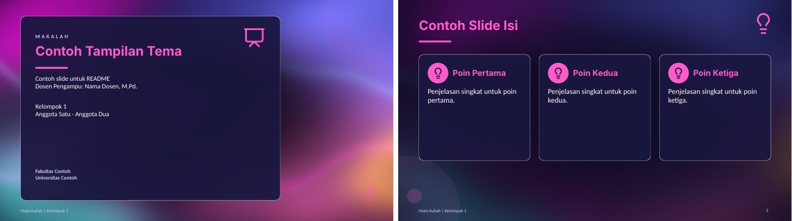

**2. Minimalis** (`--tema=minimalis`): Kertas putih, tinta hitam, aksen oranye. Cocok untuk: Jurnal, skripsi, tesis.  
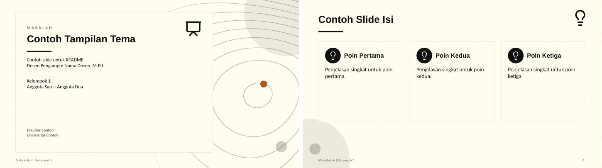

**3. Cyberpunk** (`--tema=cyberpunk`): Matahari retro, grid neon. Cocok untuk: Teknologi, AI.  
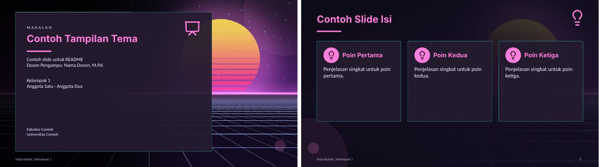

**4. Premium Design** (`--tema=premium`): Hitam keunguan dan emas. Cocok untuk: Proposal bisnis, acara resmi.  
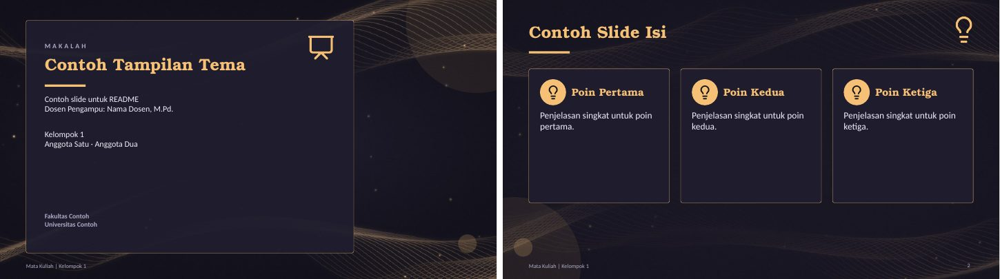

**5. Natural** (`--tema=natural`): Bukit hijau, matahari lembut. Cocok untuk: Lingkungan, pangan.  
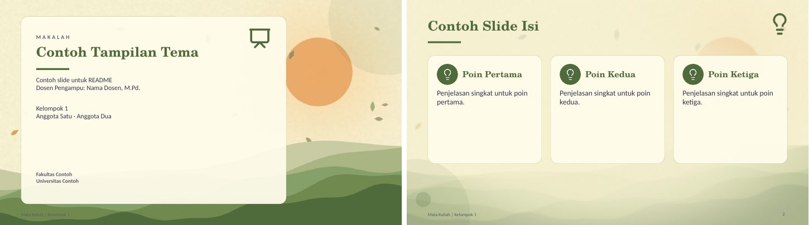

**6. Forest** (`--tema=forest`): Hutan malam berkabut. Cocok untuk: Kehutanan, konservasi.  
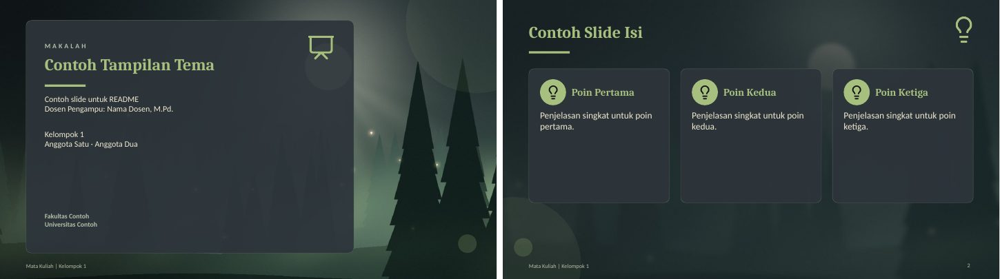

**7. Modern** (`--tema=modern`): Putih bersih, bola warna. Cocok untuk: Seminar, sidang.  
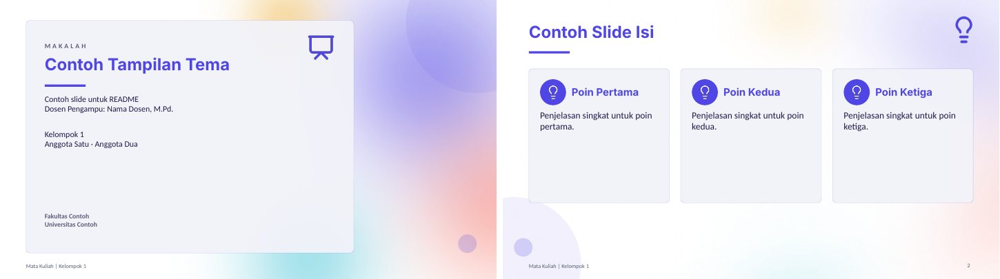

**8. Dinamis** (`--tema=dinamis`): Navy, garis kecepatan. Cocok untuk: Presentasi energik.  
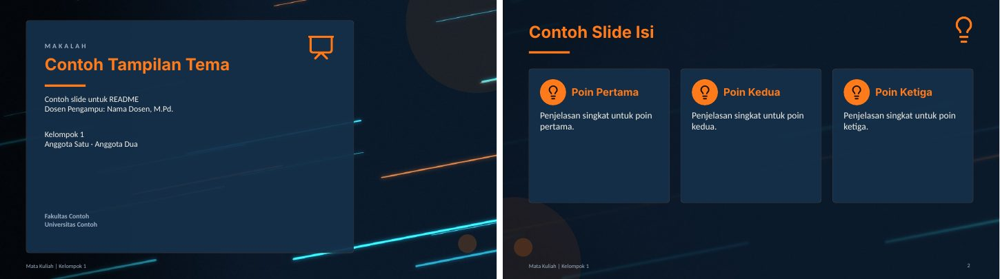

**9. Funny** (`--tema=funny`): Krem ceria, konfeti. Cocok untuk: Kelas santai.  
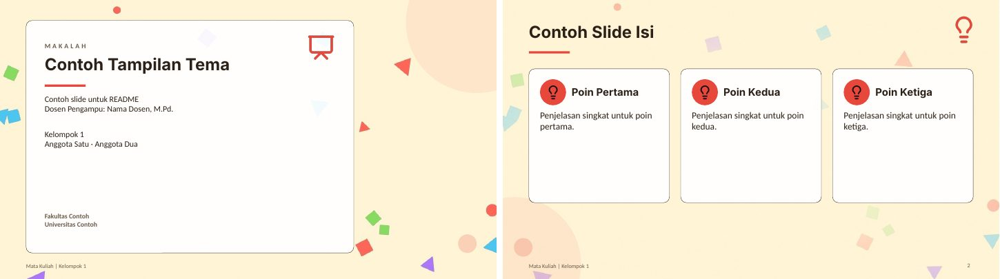

**10. Galaksi** (`--tema=galaksi`): Nebula, bintang, planet bercincin. Cocok untuk: Astronomi, fisika, sains.  
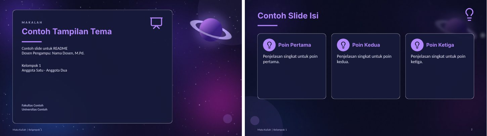

**11. Samudra** (`--tema=samudra`): Bawah laut, sinar cahaya, gelembung. Cocok untuk: Kelautan, perikanan.  
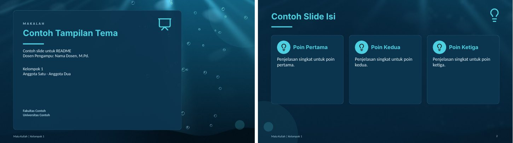

**12. Sakura** (`--tema=sakura`): Ranting sakura, kelopak berjatuhan. Cocok untuk: Budaya Asia, sastra.  
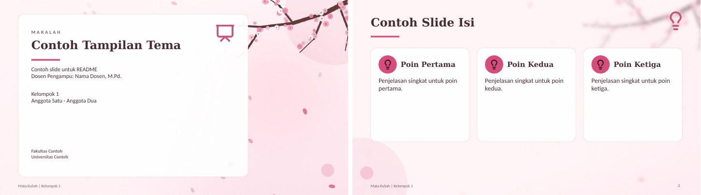

**13. Batik Nusantara** (`--tema=batik`): Motif kawung cokelat dan emas. Cocok untuk: Budaya dan sejarah Indonesia.  
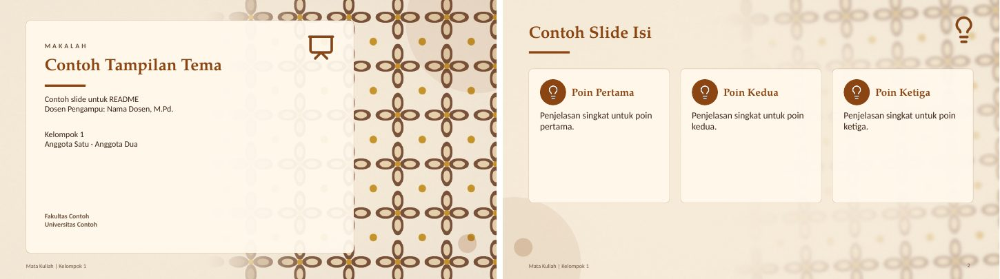

**14. Geometri Islami** (`--tema=islami`): Bintang delapan emas di atas zamrud. Cocok untuk: Studi Islam, pendidikan agama.  
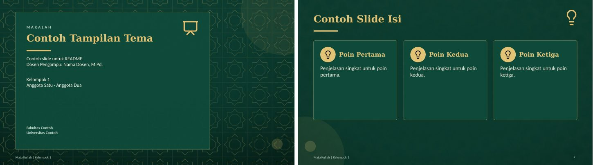

**15. Matrix** (`--tema=matrix`): Hujan kode hijau. Cocok untuk: Pemrograman, keamanan siber.  
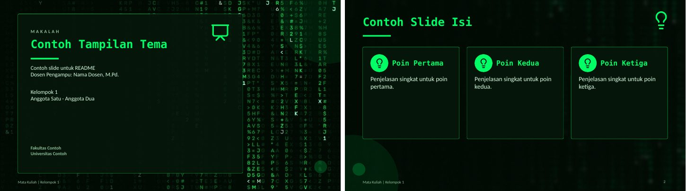

**16. Blueprint** (`--tema=blueprint`): Gambar teknik, roda gigi berputar. Cocok untuk: Teknik, arsitektur.  
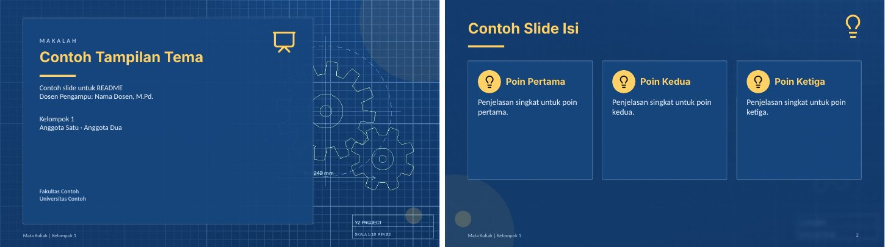

**17. Papan Tulis** (`--tema=papantulis`): Rumus kapur yang tergambar sendiri. Cocok untuk: Pendidikan, matematika.  
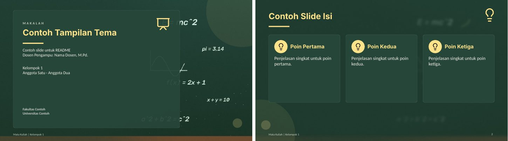

**18. Buku Catatan** (`--tema=catatan`): Kertas bergaris, coretan pena. Cocok untuk: Tugas kuliah, catatan belajar.  
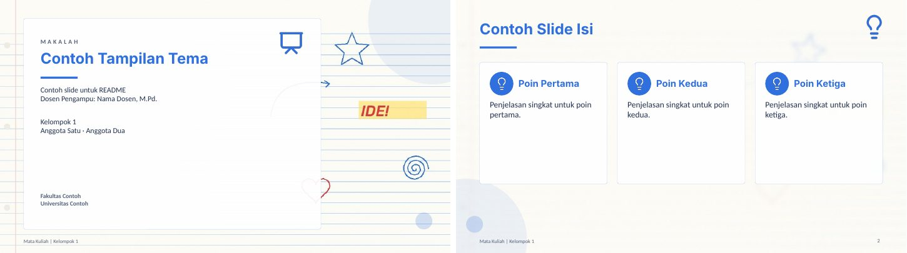

**19. Pastel** (`--tema=pastel`): Gelembung pastel lembut. Cocok untuk: Psikologi, anak, PAUD.  
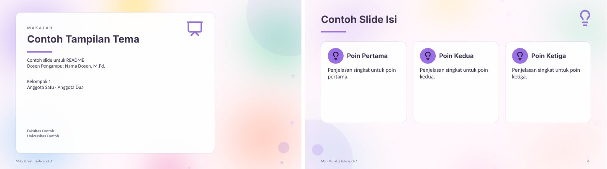

**20. Medis** (`--tema=medis`): Garis EKG dan DNA berputar. Cocok untuk: Kesehatan, kedokteran.  
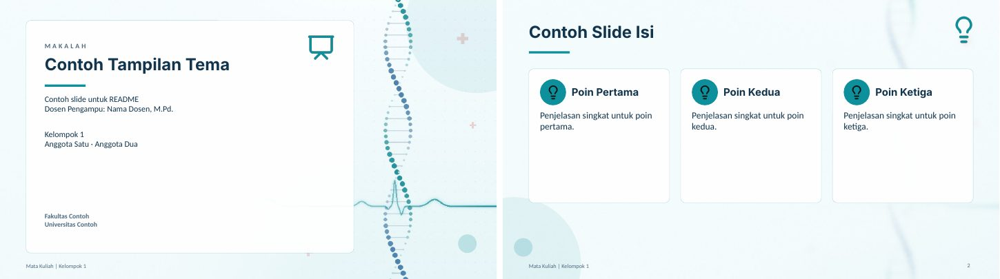

**21. Korporat** (`--tema=korporat`): Navy dengan pita diagonal. Cocok untuk: Bisnis, manajemen, ekonomi.  
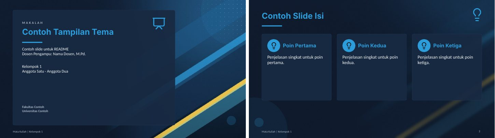

**22. Monokrom** (`--tema=monokrom`): Hitam putih, garis spirograf. Cocok untuk: Hukum, karya formal.  
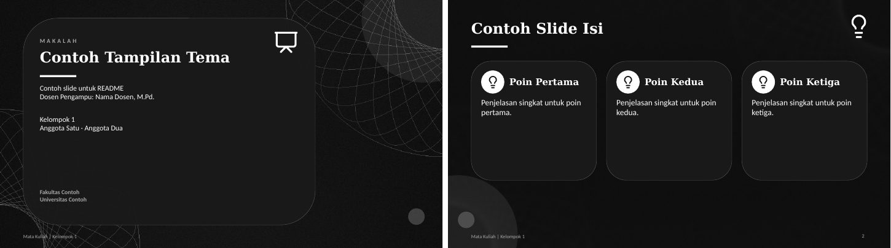

**23. Jaringan** (`--tema=jaringan`): Titik-titik terhubung yang bergerak. Cocok untuk: Data, jaringan komputer.  
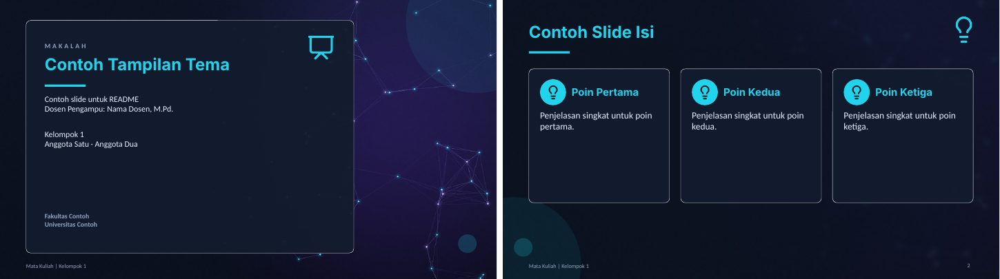

**24. Salju** (`--tema=salju`): Pegunungan malam, salju turun. Cocok untuk: Iklim, geografi.  
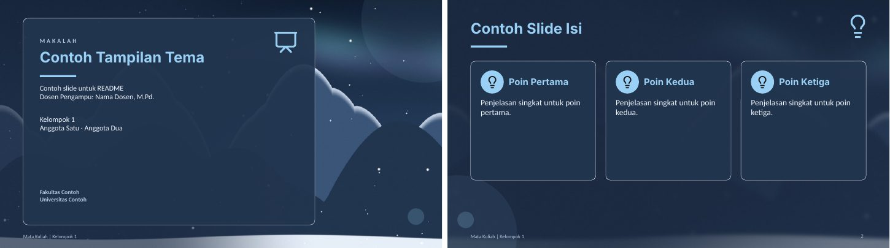

**25. Tropis** (`--tema=tropis`): Pantai, matahari, daun palem. Cocok untuk: Pariwisata, pesisir.  
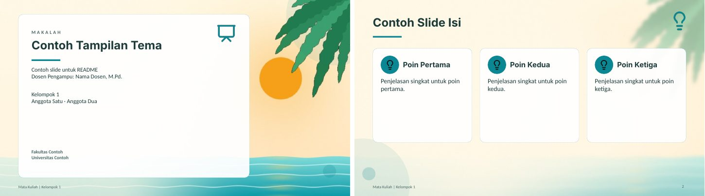

**26. Lava** (`--tema=lava`): Gumpalan lava yang mengalir. Cocok untuk: Energi, kebencanaan, kimia.  
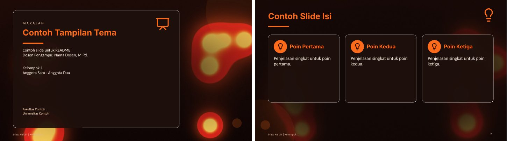

**27. Vintage** (`--tema=vintage`): Kertas tua, butiran film, ornamen. Cocok untuk: Sejarah, sastra, arsip.  
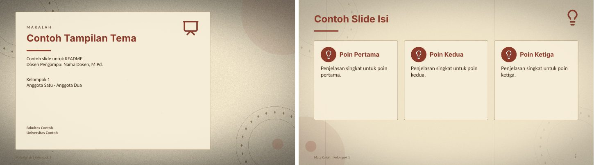

**28. Bauhaus** (`--tema=bauhaus`): Bentuk geometris warna primer. Cocok untuk: Seni, desain grafis.  
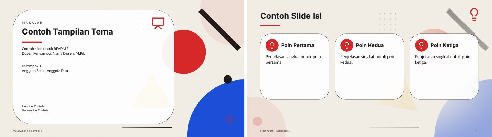

**29. Pixel** (`--tema=pixel`): Langit dan awan gaya game retro. Cocok untuk: Game, multimedia.  
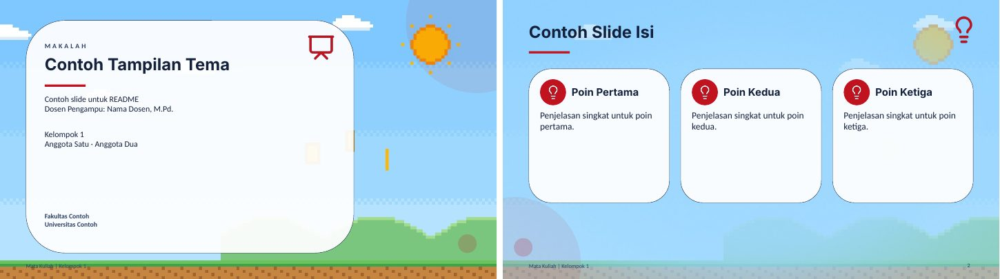

**30. Holografik** (`--tema=holografik`): Gradien pelangi berkilau. Cocok untuk: Desain, topik kreatif.  
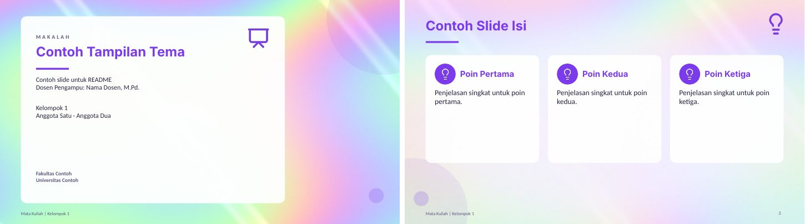

### Warna polos (`--warna`)

Tanpa gambar latar: latar isi krem, sampul dan penutup berwarna utama. Pilihan bawaan di bawah; nama lain (`--warna=ungu`) atau hex (`--warna=#7A1F5C`) juga bisa, dan warna yang terlalu terang digelapkan otomatis.

| Flag | Warna utama | Contoh |
|---|---|---|
| `--warna=hijau` | #1E4D3B | 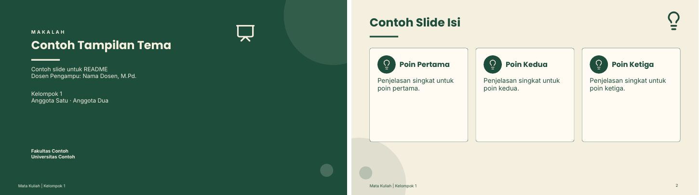 |
| `--warna=navy` | #1B2A4A | 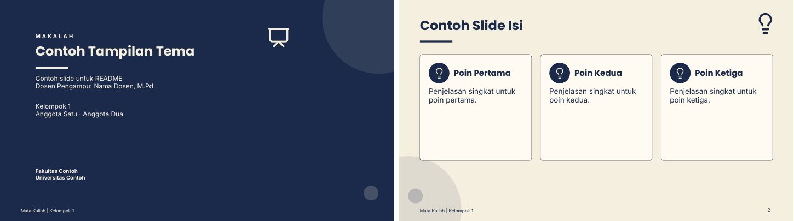 |
| `--warna=marun` | #6B1E2E | 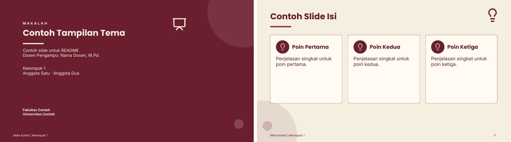 |
| `--warna=teal` | #134E4A | 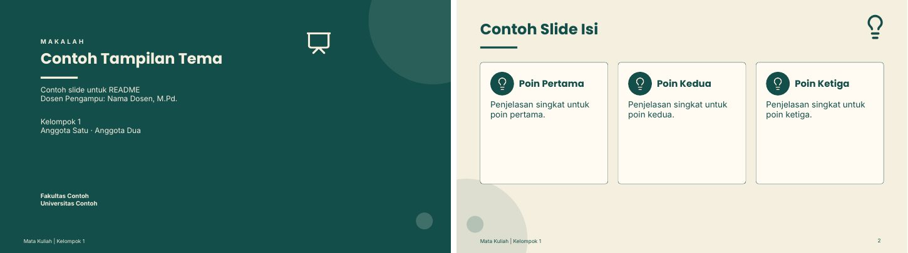 |
| `--warna=cokelat` | #4A2F1F | 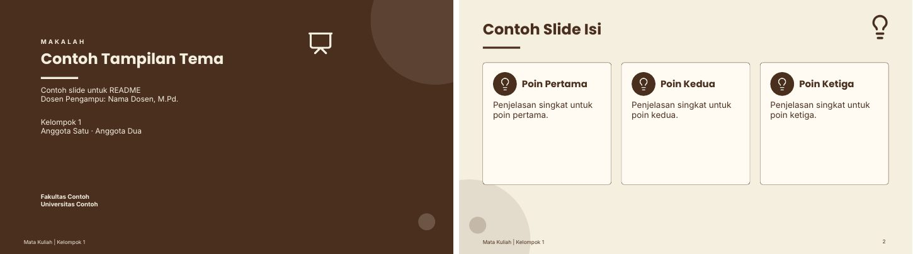 |
| `--warna=hitam` | #1C1C1E (aksen emas tipis di garis judul) | 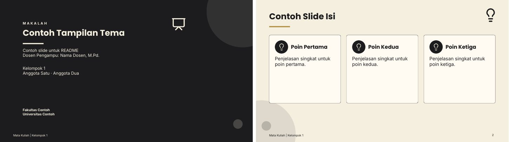 |


### Contoh prompt

Makalah biasa:

```
/dokumen-ke-ppt buatkan PPT dari makalah terlampir --tema=rekomendasi --padat
```

Tugas non-makalah (studi kasus, laporan). Skill menawarkan struktur slide lebih dulu karena sumbernya tidak berbab:

```
/dokumen-ke-ppt buatkan PPT dari tugas studi kasus BPMN terlampir --warna=hijau --slide=10
```

Presentasi kelompok dengan pembagian pembicara. Setiap slide mendapat baris `Pembicara: [Nama] | Durasi: ±N menit`, dan .docx notes memuat tabel ringkasan pembagiannya. Durasi 15 menit adalah bawaan, dan angka lain bisa disebut di prompt:

```
/dokumen-ke-ppt buatkan PPT dari makalah terlampir --tema=korporat --bagi, total durasi 15 menit
```

Warna sendiri:

```
/dokumen-ke-ppt buatkan PPT dari makalah terlampir --warna=#7A1F5C
```

## Isi repo

```
dokumen-ke-ppt/
├── SKILL.md            Alur dan aturan inti yang dibaca Claude
├── references/         Rincian per langkah (dibaca Claude hanya saat perlu)
├── README.md           Dokumentasi (Indonesia)
├── README.en.md        Dokumentasi (English)
├── CHANGELOG.md        Riwayat perubahan tiap versi
├── LICENSE             GNU General Public License v3
├── .gitignore
├── docs/               Gambar galeri tema dan warna untuk README, katalog_30_tema.jpg
├── aset/
│   ├── tema.json       30 tema (warna, font)
│   ├── kata_ikon.json  Peta kata kunci ke ikon
│   ├── latar/          Gambar latar slide isi per tema
│   ├── poster/         Gambar sampul per tema
│   └── ikon/           ikon Lucide + LICENSE-lucide.txt
└── scripts/
    ├── baca_sumber.py
    ├── gaya.py
    ├── cek_isi.py
    ├── bangun_ppt.js
    ├── buat_notes.js
    ├── add_morph.py
    ├── render_rumus.py
    ├── ikon.py
    ├── palette.py
    └── susun.js
```

### scripts/

Script dipanggil otomatis oleh skill. Bagian ini untuk yang ingin menjalankannya sendiri, dari akar repo.

**baca_sumber.py** membaca .docx, .pdf, .md, atau .txt dan menulis `sumber.txt` (teks bersih), `pustaka.txt`, `logo.png`, `_gambar/`, dan `ringkasan.json` (bab terdeteksi, cover, rumus, placeholder template, apakah OCR dipakai) ke folder `--keluar`.

```
python3 scripts/baca_sumber.py makalah.docx --keluar=kerja
python3 scripts/baca_sumber.py laporan.pdf --keluar=kerja --halaman=7   # sekalian render halaman 7
```

**gaya.py** mengubah `--tema` atau `--warna` menjadi JSON gaya (warna, font, path gambar latar) dan merekomendasikan tema dari topik.

```
python3 scripts/gaya.py --daftar
python3 scripts/gaya.py --tema=batik
python3 scripts/gaya.py --tema=kesehatan                  # kata biasa juga dikenali
python3 scripts/gaya.py --tema=rekomendasi --topik "matematika diskrit"
python3 scripts/gaya.py "--warna=#7A1F5C" --fontaman
```

**cek_isi.py** adalah dry-run untuk `isi.json`: menyeragamkan bentuk isi, memeriksa grafik (jumlah nilai, angka format Indonesia), batas item per slide, kepadatan kata, catatan kosong, naskah terhadap durasi, berkas gambar dan ikon, serta menghitung total slide. `--pecah` memecah slide yang kelebihan item, `--tulis` menyimpan hasil rapi.

```
python3 scripts/cek_isi.py isi.json --gaya-kata=singkat --durasi=15 --slide=12
python3 scripts/cek_isi.py isi.json --pecah --tulis
```

**bangun_ppt.js** membangun .pptx mentah dari `isi.json` (format ada di `references/gaya-dan-isi-json.md`), dan **buat_notes.js** membuat dokumen Speaker Notes dari berkas yang sama.

```
node scripts/bangun_ppt.js isi.json PPT-mentah.pptx
node scripts/buat_notes.js isi.json "Speaker Notes - judul.docx"
```

**add_morph.py** memasang transisi di semua slide sebuah .pptx (`--transisi=morph|fade|kombinasi`), menulis warna dan font gaya ke tema PowerPoint (`--gaya=gaya.json`), dan memberi peringatan jika objek tidak bernama `!!...`. Aman dijalankan ulang, dan file keluaran harus berbeda dari file masukan.

```
python3 scripts/add_morph.py PPT-mentah.pptx PPT-final.pptx --gaya=gaya.json --transisi=kombinasi
```

**ikon.py** mewarnai ikon Lucide dan memilih ikon dari kata kunci.

```
python3 scripts/ikon.py --auto "tujuan penulisan"
python3 scripts/ikon.py --color 1B2A4A --out ikon target users
```

**render_rumus.py** merender rumus matematika (sintaks mathtext matplotlib, subset LaTeX) menjadi PNG transparan.

```
python3 scripts/render_rumus.py --color 1B2A4A --size 32 --out rumus1.png "\binom{n}{k}=\frac{n!}{k!(n-k)!}"
python3 scripts/render_rumus.py --color F4F1E8 --batch rumus.json   # banyak rumus sekaligus
```

## Riwayat versi

Versi saat ini adalah **v3.2**. Perubahan tiap versi (v1, v2, v2.1, v2.2, v3.0, v3.1, v3.2) dicatat di [CHANGELOG.md](CHANGELOG.md), dari yang terbaru.

## Batasan yang diketahui

- **Morph:** hanya tampil di PowerPoint 2019++ dan 365. Objek yang sama di antar slide dipasangkan lewat nama berawalan `!!`; `add_morph.py` memberi peringatan jika nama itu tidak ada. Aplikasi lain memakai efek fade (atau pakai `--transisi=fade` sejak awal). Pratinjau di LibreOffice juga tidak menampilkan Morph, jadi geraknya hanya bisa diperiksa langsung di PowerPoint.
- **Font:** font tema (mis. Palatino Linotype, Century Gothic) atau Poppins, Lato, dan Amiri harus terpasang di komputer yang membuka PPT. Jika tidak, PowerPoint memakai font pengganti dan tampilan bisa bergeser. Pakai `--fontaman` untuk Calibri. Di sesi tanpa pemantauan, skill otomatis memakai font aman. File PPT tidak menyematkan font.
- **Bahasa:** slide dan notes berbahasa Indonesia, termasuk untuk sumber berbahasa Inggris (istilah teknis dipertahankan). Pakai `--en` untuk hasil berbahasa Inggris.
- **Rumus:** dirender menjadi gambar sehingga tidak bisa diedit di PowerPoint. Rumus satu baris tanpa pecahan atau akar ditulis sebagai teks biasa.
- **Animasi:** hanya transisi antar slide (Morph, Fade, Push, Wipe). Animasi masuk per objek (misalnya kartu muncul bergantian) belum ada.
- **Gaya:** gaya polos (`--warna`) selalu berlatar krem (#F5EFE0) dan hanya warna utamanya yang berganti. Tema bergambar memakai latar statis, tanpa video latar, supaya file ringan dan tampil di Google Slides atau Canva.
- **Grafik dan tabel:** native, jadi bisa diedit di PowerPoint, tetapi hanya dibuat dari data yang ada di sumber. Tabel maksimal 5 baris dan 4 kolom.
- **Jaringan:** memasang paket npm butuh akses ke registry. Di lingkungan tanpa akses itu, paket harus sudah terpasang.
- **Sesi tanpa pemantauan:** jika skill berjalan tanpa bisa bertanya, ia memakai `--warna=navy`, font aman, gaya kata `--singkat`, dan aturan jumlah slide bawaan, lalu menyebutkannya di balasan.
- **PDF scan:** hasil OCR bisa salah di angka, nama, dan ayat. Skill menandainya "perlu dicek manual".
- **Ketepatan isi:** skill menjaga angka, definisi, nama, dan ayat tetap sama dengan sumber, tetapi periksa ulang sebelum presentasi.

## Pemecahan masalah

| Gejala | Penyebab | Cara mengatasi |
|---|---|---|
| Tampilan font berantakan atau berbeda | Font belum terpasang | Pasang fontnya, atau buat ulang dengan `--fontaman` |
| Transisi tidak bergerak | Bukan PowerPoint 2019++/365 | Buka di PowerPoint, lalu cek tab Transitions: harus tertulis Morph |
| Morph jalan tapi objek tidak bergeser mulus | Nama objek tidak berawalan `!!` atau berbeda antar slide | Perhatikan peringatan `add_morph.py`, samakan nama `!!judul`, `!!ikon`, dan seterusnya |
| `File keluaran harus beda dari file masukan.` | Nama file masukan dan keluaran `add_morph.py` sama | Beri nama keluaran yang berbeda |
| `Cannot find module 'sharp'` atau `'docx'` | Paket npm tidak ditemukan | Jalankan dengan `NODE_PATH=$(npm root -g) node ...` atau `npm install sharp docx pptxgenjs` |
| `npm install` gagal dengan `ENOTFOUND registry.npmjs.org` | Registry npm tidak terjangkau dari jaringan ini | Pakai paket yang sudah terpasang global, atau pasang dari jaringan lain |
| `PERINGATAN: ikon '...' tidak ada` | Nama ikon salah | Cek `python3 scripts/ikon.py --daftar`; ikon diganti `lightbulb` sementara |
| `PERINGATAN: slide contoh ... terlalu panjang` | Isi `contoh` melebihi kartu | Kecilkan `skalaRumus`, kurangi isi, atau pecah jadi dua slide |
| `Tema '...' tidak dikenali.` | Nama atau nomor tema salah | Jalankan `python3 scripts/gaya.py --daftar` |
| `ERROR: ... jumlah nilai ... label` dari `cek_isi.py` | Jumlah nilai seri grafik berbeda dari jumlah label | Samakan jumlahnya di `isi.json` |
| `--transisi harus salah satu dari ...` | Nilai `--transisi` salah ketik | Pakai `morph`, `fade`, atau `kombinasi` |
| `require('pptxgenjs')` gagal | Node tidak menemukan paket global | Jalankan dengan `NODE_PATH=$(npm root -g) node ...` |
| `render_rumus.py` mengeluarkan galat mathtext | Ada perintah LaTeX yang tidak didukung | Sederhanakan rumus; `\frac`, `\binom`, `\sqrt`, pangkat, dan indeks didukung |
| `Warna '...' tidak dikenali.` | Nama warna tidak ada di daftar | Pakai hex: `--warna=#RRGGBB` |
| Warna hasil lebih gelap dari yang diminta | Kontras terhadap krem di bawah 4.5 (hanya `--warna`) | Itu disengaja agar teks terbaca; pilih warna yang lebih gelap sendiri jika ingin hasil persis |

## Pembuat

Dibuat oleh **Kurniawan Hafiz**. Hak cipta (c) 2026 Kurniawan Hafiz.

## Lisensi

Mulai v3.2, skill ini dirilis dengan [GNU General Public License v3.0](LICENSE) atau yang lebih baru (`GPL-3.0-or-later`). Rilis v3.1 dan sebelumnya yang sudah dibagikan dengan lisensi MIT tetap berlisensi MIT bagi yang menerimanya.

Ikon di `aset/ikon/` berasal dari [Lucide](https://github.com/lucide-icons/lucide) dan tetap berlisensi ISC (lihat `aset/ikon/LICENSE-lucide.txt`).
